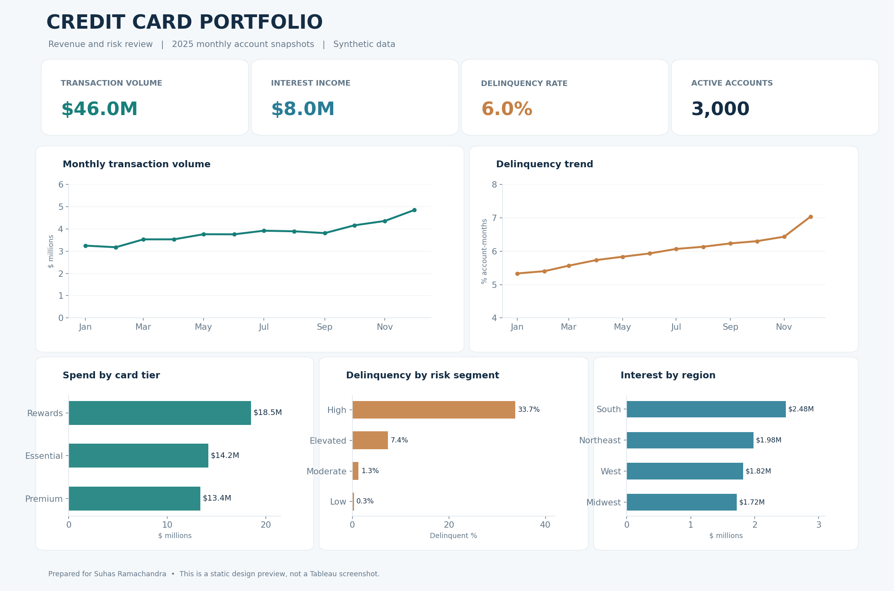

# Credit Card Revenue & Risk Analytics

**Python · SQL · Tableau · Financial Analytics**

An end-to-end analytics project exploring spending patterns, interest income, and delinquency risk across a simulated credit-card portfolio. The goal is to bring revenue and risk metrics into one clear view for a monthly business review.

> **Data:** Entirely synthetic. No real banking or customer records are used.

## Project overview

The analysis covers **3,000 fictional accounts over 12 months in 2025**, resulting in 36,000 account-month observations. I used Python to prepare and validate the data, SQL to explore portfolio performance, and summary reports to plan a Tableau visualization.

| Portfolio KPI | 2025 modeled result |
| --- | ---: |
| Transaction volume | **$46.0M** |
| Interest income | **$8.0M** |
| Account-month delinquency rate (30+ DPD) | **6.0%** |
| Unique accounts | **3,000** |
| Monthly observations | **36,000** |

## Dashboard concept



*Design preview generated from the synthetic data. The interactive Tableau Public dashboard will be linked here when available.*

## Questions explored

- How do spending and interest income change month to month?
- Which card tiers account for the greatest spending volume?
- Where do delinquency rates vary by risk segment and region?
- What signals should an analyst monitor alongside top-line revenue?

## Insights from the modeled portfolio

- **Risk trend:** The 30+ days-past-due rate rises from **5.33% in January** to **7.03% in December**. The full-year average of 6.0% does not show that month-to-month change.
- **Card mix:** The Rewards tier contributes approximately **$18.5M** in annual transaction volume, the largest of the three modeled tiers.
- **Business takeaway:** Revenue performance and delinquency should be reviewed together. A spending increase is more informative when paired with an understanding of risk trends.

Because the dataset is synthetic, these observations illustrate analytical methods rather than findings about a real financial institution.

## Technical work

- **Python / Pandas / NumPy:** Created the reproducible synthetic account-month dataset, checked uniqueness and data types, and validated financial KPIs.
- **SQL:** Wrote analytical queries for spending, interest income, card-tier performance, and delinquency trends.
- **Reporting:** Produced monthly and segment-level CSV summaries for comparison and dashboard planning.
- **Tableau:** Designed a dashboard covering four KPI cards, monthly trends, card mix, regional interest, and delinquency by risk segment. A verified interactive workbook is the next deliverable.
- **Testing:** Added automated checks for row counts, unique account-month keys, KPI totals, and delinquency definitions.

## Repository contents

| Location | Description |
| --- | --- |
| `data/` | Synthetic account-month portfolio data |
| `src/` | Data generation, validation, and reporting scripts |
| `sql/` | Reusable portfolio analysis queries |
| `reports/` | Generated monthly and segment-level summaries |
| `docs/` | Data dictionary, case study, and dashboard layout concept |
| `tests/` | Automated data and reporting checks |

## Run the analysis

Requires Python 3.10+.

```bash
python3 -m pip install -r requirements.txt
python3 src/validate_data.py
python3 src/analyze_portfolio.py
python3 -m unittest discover -s tests -v
```

For metric definitions and data-grain notes, see the [data dictionary](docs/DATA_DICTIONARY.md). For a short interpretation of the analysis, see the [case study](docs/CASE_STUDY.md).

---

**Project by Suhas Ramachandra** · [GitHub profile](https://github.com/rsuhas2001)
